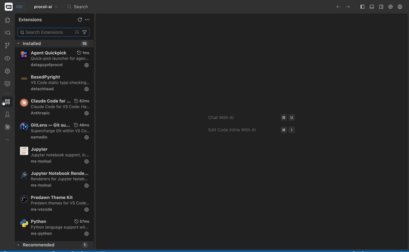

<p align="center">
  
</p>

# Agent Quickpick

**One shortcut to launch any CLI coding agent, and a ping when it needs you.**

> **Zero setup.** Hit `⌘⇧A` (or `Ctrl+Shift+A`), pick an agent, and get a dedicated terminal tab with its own icon and color theme right in your editor workspace.

Built by a dev for devs who run CLI coding agents in VS Code (or Cursor, Windsurf, Trae, Antigravity, Vodium) and got tired of juggling generic bottom-panel terminals.



---

## Why use it?

- **Zero configuration required**: It probes your `PATH` automatically and shows you only the agent CLIs you actually have installed.
- **Editor tabs, not bottom panel**: Terminals open as real editor tabs. Split them side-by-side or stacked to run Claude, Aider, and OpenCode simultaneously in the same window.
- **Icons & theme colors out of the box**: Every agent (Claude, Codex, OpenCode, Goose, Aider, etc.) gets a distinct icon and tab color so you can identify active sessions at a glance.
- **Frecency sorting**: The agents you launch most float to the top automatically. Order syncs across machines via Settings Sync.
- **Clean & non-intrusive**: Agents not found on your system stay hidden by default so your picker stays clean. Click the eye icon in the title bar anytime to reveal them.
- **Know when an agent needs you**: Codex and pi report their own state over the terminal with the [Program Status Protocol](https://www.superlogical.com/rex/docs/build/program-status) (OSC 7501); every other agent is tracked by watching its window title, progress reports and output. Either way, native OS notifications, in-editor toasts with a **Show** button, and a sound cue fire when an agent finishes, fails, or is blocked on you, even when VS Code is behind another app or on another Space. **Nothing is installed** and no agent config is touched.
- **Live session status at a glance**: The running-sessions picker shows a real-time status badge per agent: `⏸` blocked (waiting on you), `✗` error, `✓` done, `●` working, `○` idle. Double-tap `⌘⇧A` to jump to any of them.
- **Rename tabs from that same picker**: Select a running session and click the edit icon in the picker title bar (or press **R** while the filter is empty) to rename its terminal tab. Lifecycle status, notifications, status-bar counts, and click-to-focus keep working after the rename.

---

## Supported agents (out of the box)

No configuration needed. If the tool is on your `PATH`, Agent Quickpick detects it automatically:

| Agent | Command | Agent | Command |
|---|---|---|---|
| Claude | `claude` | Goose | `goose` |
| Codex | `codex` | Crush | `crush` |
| Amp | `amp` | Droid | `droid` |
| Copilot | `gh copilot` | Qwen | `qwen` |
| OpenCode | `opencode` | Plandex | `plandex` |
| Command Code | `cmd` | Grok | `grok` |
| Aider | `aider` | Kilo | `kilo` |
| Cody | `cody` | oh-my-pi | `omp` |
| Qodo | `qodo` | pi | `pi` |

There is also a **Terminal** entry, for when you want a plain shell opened the same way.

---

## Quick Install

### Option A: Install from Open VSX (recommended)

The extension is published on the [Open VSX Registry](https://open-vsx.org/extension/dataguyofprocol/agent-quickpick), the open-source marketplace used by VSCodium, Cursor, Windsurf, Trae, Antigravity, and other VS Code-based editors. From those editors you can install it directly from the Extensions panel.

Vanilla **VS Code** doesn't browse Open VSX natively (it uses Microsoft's Marketplace), but you can install the extension from Open VSX in two ways:

1. **Download the `.vsix`** from the [Open VSX page](https://open-vsx.org/extension/dataguyofprocol/agent-quickpick) (click **Download**).
2. In VS Code, open Extensions (`⌘⇧X` / `Ctrl+Shift+X`).
3. Click `⋯` (top right) → **Install from VSIX…** and select the file.

Or, from the command line:

```bash
code --install-extension <path-to-downloaded-.vsix>
```

You get automatic update checks by pinning to the [Open VSX listing](https://open-vsx.org/extension/dataguyofprocol/agent-quickpick) in editors that natively use Open VSX (Cursor, Windsurf, VSCodium). Vanilla VS Code will **not** auto-update from Open VSX, so you'll need to re-download newer `.vsix` releases as they're published.

### Option B: Grab a build from CI

1. Download the latest `.vsix` from [GitHub Actions Artifacts](https://github.com/dataguyofprocol/agent-quickpick/actions).
2. Install via **Install from VSIX…** as above.

*(Submitting to the VS Code Marketplace soon!)*

---

## Optional: Custom agents & tweaks

Most developers never need to touch settings. But if you have custom scripts, package-manager launchers, or want to hide specific built-in agents, configure `agentQuickpick.agents` in `settings.json`:

```jsonc
"agentQuickpick.agents": [
  {
    "name": "Claude GLM",
    "cmd": "claude-glm",
    "icon": "claude-glm.svg",
    "color": "agentQuickpick.claudeGlm"
  },
  {
    "name": "Aider (uvx)",
    "cmd": "aider",
    "launcher": "uvx",       // probes `uvx` on PATH, launches `uvx aider`
    "icon": "aider.svg"
  },
  { "name": "Droid", "hidden": true }
]
```

### Handy settings

- **Using shell aliases / functions**: If your agents rely on shell aliases rather than binaries on `PATH`, turn off detection so they aren't hidden:
  ```jsonc
  "agentQuickpick.detectInstalled": false
  ```
- **Terminal activation scripts leaking into prompt**: If virtualenv/conda activation scripts bleed into an agent's stdin on open, adjust `launchDelayMs` (default 300ms):
  ```jsonc
  "agentQuickpick.launchDelayMs": 500
  ```

### Lifecycle notifications

Agent Quickpick reports when an agent finishes, fails, or is blocked waiting for you. **Nothing is installed and no agent configuration is modified.**

The [Program Status Protocol](https://www.superlogical.com/rex/docs/build/program-status) exists so a program can say what it is doing instead of having its screen guessed at. Mitchell Hashimoto's [announcement post](https://mitchellh.com/writing/program-status-osc7501) and [his post on X](https://x.com/mitchellh/status/2107577887159386152) make the case plainly ("Heuristics are not the way") and note that Herdr needed around ten compatibility changes just to keep detecting Claude Code over three months. That is the right direction, and it is why this extension prefers the protocol over guessing. The reason it still infers so much is a handshake gap in VS Code, not a preference; the note below explains it.

**How the status is determined**, best evidence first:

1. **The Program Status Protocol ([OSC 7501](https://www.superlogical.com/rex/docs/build/program-status))** — an agent that reports its own state is believed, including its `msg`, `title`, `progress` and hierarchical records. Which agents do that, and whether it works here, is the table below.
2. **Inference**, for everything else: the window title (spinner glyphs, idle marks), `OSC 9;4` progress reports, and the last lines of output, matched against per-agent rules ported from [Herdr](https://github.com/herdrdev/herdr)'s detection manifests (see [THIRD_PARTY_NOTICES.md](./THIRD_PARTY_NOTICES.md)). Inference is deliberately conservative: it updates the status bar and the sessions picker, and the *only* inference allowed to raise a notification is an explicit permission/approval prompt; a wrong "needs you" alert is worse than a missing one. Set `agentQuickpick.fallbackDetection: false` to trust the protocol alone.
3. **The process exit code** — always available, and the only thing besides the protocol allowed to claim `done` or `error`.

`done` and `error` survive the agent exiting (the result is still there to look at); `working` and `blocked` are dropped when the process ends or you run something else.

#### Which agents report their own status

| Agent | OSC 7501 support | In VS Code |
| --- | --- | --- |
| **Codex** | Yes — [openai/codex#52725](https://github.com/openai/codex/pull/52725) (merged 2026-10-09) | ✅ **Reports.** Codex emits whenever stdout is a terminal, so no handshake is needed. Needs a build from after 2026-10-09 — 0.159.0 and earlier do not emit. |
| **pi ≥ 1.1.0** | Yes — [pi#10607](https://github.com/earendil-works/pi/issues/10607), [commit 503c605](https://github.com/earendil-works/pi/commit/503c605528f9af993c0e37ede468cf884fb0ff5b) | ✅ **Reports.** pi waits for the terminal's handshake, so Agent Quickpick sets pi's own documented `PI_PROGRAM_STATUS=1` for terminals it launches. |
| **Claude Code ≥ 2.1.295** | Yes — [release notes](https://github.com/anthropics/claude-code/releases/tag/v2.1.295), [docs](https://code.claude.com/docs/en/terminal-config) | ✅ **Reports, via our reporter.** Claude waits for a handshake VS Code can't answer, so Agent Quickpick launches it with `--settings` hooks that print OSC 7501 for it (see below). |
| **Droid 0.237+** | Yes — present in the shipped CLI (it contains the OSC 7501 prefix and its handshake query) | ⚠️ **Silent,** same handshake. |
| **Crush** | Yes — [charmbracelet/crush#4041](https://github.com/charmbracelet/crush/pull/4041) | Untested here; Crush is not a built-in agent. |
| **OpenCode (V2)** | Requested — [anomalyco/opencode#54179](https://github.com/anomalyco/opencode/issues/54179), PR #54402 | ✅ **Reports, via our reporter** — a TUI plugin passed at launch (see below). |
| Qwen Code, Gemini CLI, Goose, Kilo Code, Kimi | Requested, not shipped | Inferred (step 2). |
| Amp, Aider, Cline, Cody, Command Code, Cursor, Grok, Plandex, Qodo, Letta, Kiro | No support found | Inferred (step 2). |

**Why some agents stay silent.** The protocol lets a program *ask* the terminal whether it supports OSC 7501 (`OSC 7501 ; ?`) and, per the spec, treat "no answer" as unsupported. Claude Code, pi and Droid all do this, and they need the answer to arrive *before* the terminal's own device-attributes reply (`CSI c`). VS Code does not implement OSC 7501, so it never answers, and Agent Quickpick cannot answer for it: the only channel available to an extension writes into the agent's input too late to beat VS Code's own reply, and an answer that arrives after that reply is ignored by design.

So inference is not a legacy fallback here; it is what actually tracks most agents in VS Code today, including Claude Code. Where an agent ships its own override we use it, and for Claude Code and OpenCode we supply a launch-time reporter:

- **pi** — `PI_PROGRAM_STATUS=1` is pi's documented way to report without the handshake. Agent Quickpick sets it for pi terminals (pi ≥ 1.1.0; harmless on older versions), and **never overrides a value you set yourself**. If you export `PI_PROGRAM_STATUS=0`, nothing is injected.
- **Claude Code** — no equivalent switch exists, so Agent Quickpick launches `claude` with `--settings` pointing at [`reporters/claude-settings.json`](./reporters/claude-settings.json): hooks for that process only, layered on your own settings and run alongside your own hooks, that print the OSC 7501 report Claude would have sent (`working` on a prompt, `blocked` on a permission or question, `done` / `error` when the turn ends). Nothing is written to `~/.claude`. Skipped if your configured command already passes `--settings`.
- **OpenCode (V2)** — doesn't emit OSC 7501 yet. Agent Quickpick sets `OPENCODE_CLI_CONFIG_CONTENT` for the terminals it launches so OpenCode loads a small TUI plugin ([`reporters/opencode`](./reporters/opencode/tui.js)) that reports the session on screen. Your own `cli.json` plugins are kept (they are copied into that variable, because it replaces the plugin list rather than adding to it); if your `cli.json` can't be read, the reporter is skipped instead. Nothing is written to OpenCode's config.
- Both reporters are POSIX-only (not on Windows), apply only when the command is literally `claude` / `opencode`, and can be turned off with `agentQuickpick.agentStatusReporters`.
- **Droid** — no equivalent switch and no hook route yet; inferred. Claude Code 2.1.296 also has an [open bug](https://github.com/anthropics/claude-code/issues/101114) where native reports don't fire even when a terminal *does* answer.

Notifications reach you through three channels:

| Channel | Setting | Default |
| --- | --- | --- |
| In-editor toast, with a **Show** button | `agentQuickpick.lifecycleNotifications` | on (master switch) |
| Native OS notification (macOS Notification Center, Windows toast, `notify-send`) | `agentQuickpick.systemNotifications` | `always` |
| Agent Quickpick's own sound cue | `agentQuickpick.notificationSound` | on |

**Status vocabulary.** `⏸` blocked (with the reason: permission, a question, or a login), `✗` error (with the exit code when we have it), `✓` done, `●` working, `○` idle, `?` unknown, what a tab that has not reported anything yet shows (for example, one adopted after a window reload).

**Rate limiting.** Anything a protocol record triggers outside the terminal (a notification, a sound) is limited to one alert per session every two seconds, per the protocol's own recommendation to terminals.

The OS notification fires **every time** by default: it's the only channel that reaches you outside the editor and the only one that persists in Notification Center, while a VS Code toast is invisible when the window is behind another app or on another Space, exactly when "the agent needs you" matters. Set `whenUnfocused` if the doubled alert while you're looking at VS Code bothers you, or `off` for toasts only.

On macOS, lifecycle notifications use a bundled universal [`terminal-notifier`](https://github.com/julienXX/terminal-notifier) (x86_64 + arm64), and clicking one opens the running editor and jumps to that agent's terminal. A user-installed copy (`brew install terminal-notifier`) is preferred when found; Homebrew/MacPorts paths are checked directly because a Finder-launched editor doesn't inherit your shell's `PATH`. The click-to-focus URI works even in editor forks that don't expose a conventional app bundle id. Agent Quickpick deliberately does **not** fall back to `osascript`: macOS attributes that to Script Editor, producing the misleading Script Editor notification and Finder/script-URL click behavior. If the notifier cannot run, the in-editor toast remains available instead.

One sound for every status. Its job is to get your attention; the toast says which agent and what happened. It plays wherever the notification lands. Point `agentQuickpick.notificationSoundPath` at your own **16-bit PCM WAV** to replace it (WAV is the only format playable on all three platforms).

**Requirement: VS Code 1.93 or newer**, because reading an agent's terminal output is what makes any of this possible. On older builds the status bar simply stays on `?` until an agent exits.

**If you upgraded from a version that installed hooks**, run **Remove Legacy Lifecycle Hooks** from the Command Palette (or turn off `agentQuickpick.lifecycleNotifications`) to take them out. Agent Quickpick also strips them automatically once on the first activation after upgrading, so an obsolete hook can't keep spawning a process on every agent turn. Removing them touches only entries carrying Agent Quickpick's own marker; your hooks are never modified.

### Keyboard shortcuts

One binding does both jobs. No second shortcut to remember, and nothing of VS Code's own is shadowed. The default is `⌘⇧A` / `Ctrl+Shift+A`.

| Default shortcut | Action |
| --- | --- |
| `⌘⇧A` / `Ctrl+Shift+A` | Open the agent launcher |
| `⌘⇧A` twice | Open running agent sessions — pick one to focus it |
| `⌘⇧A` again while the launcher is open | Switch to running agent sessions |
| `R` (in running sessions, empty filter) | Rename the selected agent tab |

Double-tap with nothing running just re-opens the launcher, so the gesture is never a dead end. `Agent Quickpick: Running Sessions` is also on the status-bar item and in the Command Palette.

**Change the shortcut.** Run **Agent Quickpick: Change Agent Quickpick Shortcut** to jump straight into VS Code's Keyboard Shortcuts editor on this binding (or open it with `⌘K ⌘S` / `Ctrl+K Ctrl+S` and search `agentQuickpick.open`), then assign any key or chord. The double-tap and launcher-swap gestures are tied to the command, not the key, so they work with whatever you bind.

### Status bar

The **Agent** item shows a live count of running agents **for the active repo only**; terminals launched from another folder in the same window don't inflate it. Click it to jump to a session. Hide it with `agentQuickpick.showStatusBar: false`.

---

## Performance baseline

The repo carries a micro-benchmark suite over the extension's data-plane hot paths: `npm run bench` (details in [MAINTAINERS.md](./MAINTAINERS.md)). Baseline captured **2026-10-11** on Apple silicon (darwin arm64, Node v26.8.1), extension v0.13.0:

| Scenario | median | p95 | ops/s | heap/op |
| --- | ---: | ---: | ---: | ---: |
| osc7501: parse + snapshot (realistic burst) | 1.9 µs | 2.6 µs | 533.3k/s | 15 B |
| signals: title + progress + text tail (realistic burst) | 3.2 µs | 3.6 µs | 311.7k/s | 12 B |
| status: classify from a permission prompt (24-line tail) | 6.1 µs | 6.6 µs | 163.3k/s | 1 B |
| status: classify with no rule match (activity/idle decay) | 458 ns | 708 ns | 2.18M/s | 3 B |
| legacy: strip our hooks (~500 KB config) | 20.5 µs | 26.8 µs | 48.7k/s | 46 B |
| legacy: cleanup pass over every target (in-memory IO) | 11.0 µs | 15.3 µs | 90.9k/s | 198 B |
| legacy: read + write config JSON (~500 KB) | 598.4 µs | 704.8 µs | 1.7k/s | 0 B |
| poll: exit statuses (500 terminals) | 30.0 µs | 33.1 µs | 33.3k/s | 0 B |
| frecency: recordLaunch (10k-entry map) | 340.3 µs | 434.6 µs | 2.9k/s | 0 B |
| frecency: sort 320 agents | 30.0 µs | 34.4 µs | 33.4k/s | 1 B |
| agents: loadAgents (20 built-ins + 200 user) | 16.7 µs | 21.6 µs | 60.0k/s | 0 B |
| render: statusBar text+tooltip (500 sessions) | 57.6 µs | 64.1 µs | 17.4k/s | 5 B |

Reading it: per-op times for the median iteration of each scenario; `heap/op` is retained-after-GC delta, so transient garbage shows as ~0. These numbers are machine- and load-specific; they exist to track **our own refactors over time**, not as absolutes. To A/B a change: `npm run bench` before and after, then `npm run bench -- --compare <old-snapshot> <new-snapshot>` (snapshots land in the gitignored `bench-results/` dir). Back-to-back runs of identical code jitter a few percent; treat deltas under 10% as noise.

---

## License & Notes

- License: [MIT](./LICENSE) *(Icons are stylized original artwork)*
- Contributing: [CONTRIBUTING.md](./CONTRIBUTING.md)
- Security policy & vulnerability reporting: [SECURITY.md](./SECURITY.md)
- Maintenance & local setup notes: [MAINTAINERS.md](./MAINTAINERS.md)
- Release history: [CHANGELOG.md](./CHANGELOG.md)
